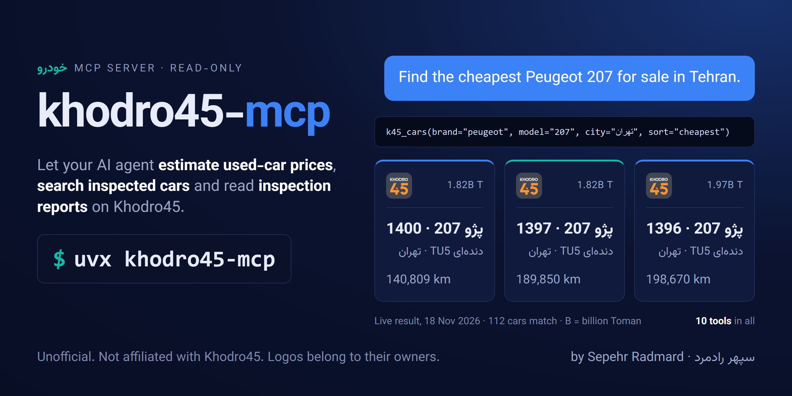

<!-- mcp-name: io.github.sepehr071/khodro45-mcp -->

<div align="center">



# khodro45-mcp: Khodro45 (خودرو۴۵) Iranian used-car marketplace MCP server for AI agents

**khodro45-mcp is an unofficial, read-only MCP server that lets an AI agent estimate used-car prices, search inspected cars for sale, read listings and inspection reports, and see real sale prices on Khodro45 (خودرو۴۵, khodro45.com), an Iranian used-car marketplace.**<br>
Its 10 tools list brands, models, trims and years, give the public used-car price estimate, search the cars listed for sale, read one listing in full and its expert inspection report, list recent real sales and show zero-km market prices.<br>
No API key or Khodro45 account is needed; it works in Claude, Cursor, Copilot and any other MCP client.

[](https://pypi.org/project/khodro45-mcp/)
[](https://pypi.org/project/khodro45-mcp/)
[](https://github.com/sepehr071/khodro45-mcp/actions/workflows/ci.yml)
[](https://github.com/sepehr071/khodro45-mcp/blob/main/LICENSE)

[For AI agents](#for-ai-agents) · [Quick start](#quick-start) · [Tools](#tools) · [Limits](#limits) · [فارسی](#فارسی)

</div>

---

## For AI agents

- **What:** unofficial MCP server (model context protocol) for khodro45.com: the public used-car price estimate, inspected cars for sale, listing details, inspection reports, recent sales and zero-km market prices.
- **Install:** `uvx khodro45-mcp` or `claude mcp add khodro45 -- uvx khodro45-mcp`. Transport: stdio. Needs [uv](https://docs.astral.sh/uv/getting-started/installation/) (Python 3.10+).
- **Auth:** none. Optional `KHODRO45_MCP_PROXY` (HTTP proxy URL, or a comma-separated list); system proxy settings are ignored.
- **Access:** read-only. It cannot log in, book an inspection, sell a car or buy one. Seller names and phone numbers are never returned.
- **Tools:** 10, all prefixed `k45_`. Typical sequences: `k45_brands` -> `k45_models` -> `k45_trims` -> `k45_price_estimate`; `k45_cars` -> `k45_car` -> `k45_inspection`; `k45_deals` for what really sold.
- **Use when:** the user asks what a used car is worth, wants to find a used car in an Iranian city under a budget, wants a car's inspection report or defects, or asks what cars recently sold for.
- **Output:** compact JSON. Prices are Toman, mileage is km, years are Persian (Gregorian for imported cars). Names are Persian with English brand names where the site has them.

## Quick start

You need [uv](https://docs.astral.sh/uv/getting-started/installation/). No API key or account.

Claude Code:

```bash
claude mcp add khodro45 -- uvx khodro45-mcp
```

Claude Desktop, Cursor, VS Code and other clients:

```json
{
  "mcpServers": {
    "khodro45": { "command": "uvx", "args": ["khodro45-mcp"] }
  }
}
```

Example prompts:

- "What is a Samand EF7 1396 with 150,000 km worth?"
- "Find the cheapest Peugeot 207 for sale in Tehran and show me its inspection report."
- "What did used Kia cars really sell for on Khodro45 lately?"
- <span dir="rtl">قیمت پژو ۲۰۷ مدل ۱۴۰۰ در تهران چقدر است؟</span>
- <span dir="rtl">گزارش کارشناسی این خودرو را نشان بده.</span>

Real answer (18 Nov 2026): `k45_price_estimate(trim_id=1849, year=1396, km=150000)` (Samand EF7) returned a market price of 1,570,000,000 Toman (range 1,511,000,000 to 1,628,000,000) and a Khodro45 offer of about 1,461,000,000 Toman. `k45_cars(brand="peugeot", model="207", city="تهران", sort="cheapest")` listed 112 cars, the cheapest at 1,818,000,000 Toman.

## Tools

| Tool | What it returns |
|---|---|
| `k45_brands` | Car brands, optionally filtered by name |
| `k45_models` | The models of one brand |
| `k45_trims` | The trims of a model and their model years |
| `k45_price_estimate` | Public used-car price estimate (market range and Khodro45's own price) for a trim, year and mileage |
| `k45_cities` | The cities with listings |
| `k45_cars` | Used cars for sale: filter by brand, model, city, price, year, km, gearbox, installments |
| `k45_car` | One listing in full: price, specs, document and ownership facts, photos |
| `k45_inspection` | The public expert inspection report: section scores and every found defect |
| `k45_deals` | Used cars Khodro45 really sold lately, with sale price, km, city and quality |
| `k45_new_car_prices` | Today's zero-km market, factory and dealer prices of a brand, or the market indexes |

## Limits

- The estimate is for a car with no defects (the public form sends none). Khodro45's own offer varies by about 1% between identical calls; the market price is stable.
- Card prices exclude the service fee; `price_toman` is the final price the page shows and `car_price_toman` the car's own price. The price filters apply to the car price.
- Listing pages are cached for a few minutes, so the site can lag the API by a few new listings.
- The city list has 87 cities; a few listings sit in smaller cities outside it, so `city` cannot filter those. Fuel type and seat colour are numeric codes with no public legend and are not exposed.
- The overall "health score" in `k45_inspection` is computed from the section scores (it is not in the API); it matched the page on the cars checked.
- Booking, selling, login and agent contact details are not covered. Khodro45 answered both Iranian and foreign networks in testing; if yours is blocked, set `KHODRO45_MCP_PROXY`.

## فارسی

<div dir="rtl">

**khodro45-mcp** یک سرور MCP غیررسمی و فقط‌خواندنی برای خودرو۴۵ (khodro45.com) است. با آن یک عامل هوش مصنوعی می‌تواند برند، مدل و تیپ خودروها را ببیند، قیمت کارشناسی خودروی کارکرده را بر اساس سال و کارکرد تخمین بزند، خودروهای کارشناسی‌شدهٔ آگهی‌شده را جست‌وجو کند، جزئیات هر آگهی و گزارش کارشناسی آن را بخواند، قیمت فروش واقعی خودروهای اخیر و قیمت بازار خودروی صفر را ببیند. بدون حساب کاربری و کلید API کار می‌کند. نصب در Claude Code:

</div>

```bash
claude mcp add khodro45 -- uvx khodro45-mcp
```

## Development

```bash
uv sync
uv run ruff check . && uv run ruff format --check .
uv run python -m pytest -q          # offline tests on recorded fixtures
uv run python -m pytest -m live -q  # live calls to khodro45.com
```

Releases: bump the version in `pyproject.toml` and `server.json`, run `uv lock`, then push a `v*` tag; GitHub Actions publishes to PyPI.

## Disclaimer

Unofficial and not affiliated with or endorsed by Khodro45. It is read-only and uses the public pages and API of khodro45.com, which can change without notice.

## Author

Built and maintained by **Sepehr Radmard** (سپهر رادمرد). [LinkedIn](https://www.linkedin.com/in/sepehr-radmard) · [GitHub](https://github.com/sepehr071) · more servers in [iran-mcp](https://github.com/sepehr071/iran-mcp).

## مجوز استفاده (License)

<a href="https://www.linkedin.com/in/sepehr-radmard"></a>

**استفادهٔ شخصی و غیرتجاری رایگان است.** استفاده در شرکت، محصول پولی یا پروژهٔ مشتری به مجوز تجاری نیاز دارد؛ از راه [لینکدین](https://www.linkedin.com/in/sepehr-radmard) یا [گیت&zwnj;هاب](https://github.com/sepehr071) با سپهر رادمرد تماس بگیرید. متن کامل: [PolyForm Noncommercial 1.0.0](https://github.com/sepehr071/khodro45-mcp/blob/main/LICENSE).

Free for personal and non-commercial use under the [PolyForm Noncommercial License 1.0.0](https://github.com/sepehr071/khodro45-mcp/blob/main/LICENSE). Using it in a company, a paid product or a client project needs a commercial license: contact Sepehr Radmard on [LinkedIn](https://www.linkedin.com/in/sepehr-radmard) or [GitHub](https://github.com/sepehr071).
